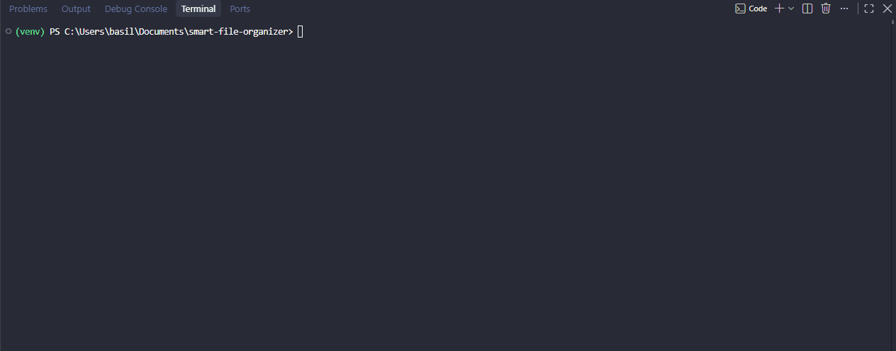

# Smart File Organizer

> A Python command-line tool that automatically sorts a messy folder (like Downloads) into tidy category folders — safely.




## 📌 About

My Downloads folder had hundreds of files: PDFs, installers, screenshots, zip files, all mixed together.
I built this tool to organize them automatically, and as my first project to learn Python by building something real (#BuildInPublic).

The main design goal was **safety**: the tool never deletes or overwrites a file, never touches system files, and lets you preview every change before it happens.

## ✨ Features

- ✅ **Sorts files by type** into folders such as `Images/`, `Documents/`, `Archives/`, `Installers/`
- ✅ **Dry-run mode** (`--dry-run`): see exactly what would happen without moving anything
- ✅ **Never overwrites**: if `report.pdf` already exists, the new file becomes `report (1).pdf`
- ✅ **Skips system and temporary files** (`desktop.ini`, `thumbs.db`, Office `~$` files, hidden files)
- ✅ **Configurable without touching code**: categories and ignore rules live in `config.json`
- ✅ **Logging** with timestamps to the console and to `organizer.log`, with a summary at the end of each run
- ✅ **Input validation**: clear error message if the folder does not exist
- 🔜 Duplicate detection by file content (hashing)
- 🔜 Unit tests with `pytest`

## 🛠️ Technologies

| Technology | Used for |
|---|---|
| Python 3.13 | Main language |
| `pathlib` | Working with files and paths across operating systems |
| `shutil` | Moving files |
| `argparse` | Command-line arguments (`--folder`, `--dry-run`, `--help`) |
| `json` | Reading the configuration file |
| `logging` | Timestamped logs to console and file |

No external libraries: everything uses the Python standard library.

## 🚀 Installation

### Prerequisites
- Python 3.10 or newer

### Steps
```bash
git clone https://github.com/vasilis-sakellariou/smart-file-organizer.git
cd smart-file-organizer
python -m venv venv
source venv/Scripts/activate      # Windows (Git Bash)
# venv\Scripts\Activate.ps1       # Windows (PowerShell)
# source venv/bin/activate        # macOS / Linux
```

## 📖 Usage

**Always preview first:**
```bash
python organizer.py --folder ~/Downloads --dry-run
```

**Then organize for real:**
```bash
python organizer.py --folder ~/Downloads
```

**See all options:**
```bash
python organizer.py --help
```

Example output:
```text
2026-10-18 17:36:32 [INFO] === Started (REAL RUN) on folder: test_folder ===
2026-10-18 17:36:32 [INFO] Moved: backup.zip -> Archives/
2026-10-18 17:36:32 [INFO] Moved: cv.pdf -> Documents/ (renamed to 'cv (1).pdf')
2026-10-18 17:36:32 [WARNING] Skipped: desktop.ini
2026-10-18 17:36:33 [INFO] Moved: photo.jpg -> Images/
2026-10-18 17:36:33 [INFO] === Finished: 8 files processed, 2 skipped ===
```

If you run it without `--folder`, it uses the safe `test_folder` sandbox.

## ⚙️ Configuration

Edit `config.json` to add categories or extensions, with no code changes needed:

```json
{
    "categories": {
        "Images": [".jpg", ".jpeg", ".png", ".gif", ".webp", ".avif"],
        "Videos": [".mp4", ".mkv", ".avi"]
    },
    "ignore": {
        "files": ["desktop.ini", "thumbs.db"],
        "prefixes": ["~$", "."]
    }
}
```

Files with an unknown extension go to `Others/`.

## 🏗️ Project Structure

```text
smart-file-organizer/
├── organizer.py     # main script
├── config.json      # categories and ignore rules
├── docs/
│   └── demo.gif     # demo for this README
├── .gitignore
├── LICENSE
└── README.md
```

## 🧠 What I Learned

- **Safety first in automation:** a script that moves files must be tested in a sandbox and offer a dry-run mode before touching real data.
- **Separating data from logic:** moving the categories to `config.json` meant new file types need zero code changes.
- **Edge cases matter:** a real dry run on my own Downloads folder revealed problems I had not thought of: system files like `desktop.ini`, Office temp files (`~$`), and files with the same name.
- **Reading errors:** `NameError`, `KeyError` and `FileNotFoundError` taught me to read a traceback from the bottom up.
- **Small commits:** every feature was built and committed as a separate, working step.

## 🗺️ Roadmap

- [ ] Detect duplicate files by content (SHA-256 hash)
- [ ] Unit tests with `pytest`
- [ ] `--undo` option using the log file
- [ ] Optional scheduled run (e.g. every night)

## 🤝 Contributing

Feedback and pull requests are welcome! Open an issue for suggestions or bugs.

## 📄 License

MIT, see [LICENSE](LICENSE).

## 👤 Author

**Vasilis Sakellariou** · Informatics student @ University of Piraeus · [GitHub](https://github.com/vasilis-sakellariou)
